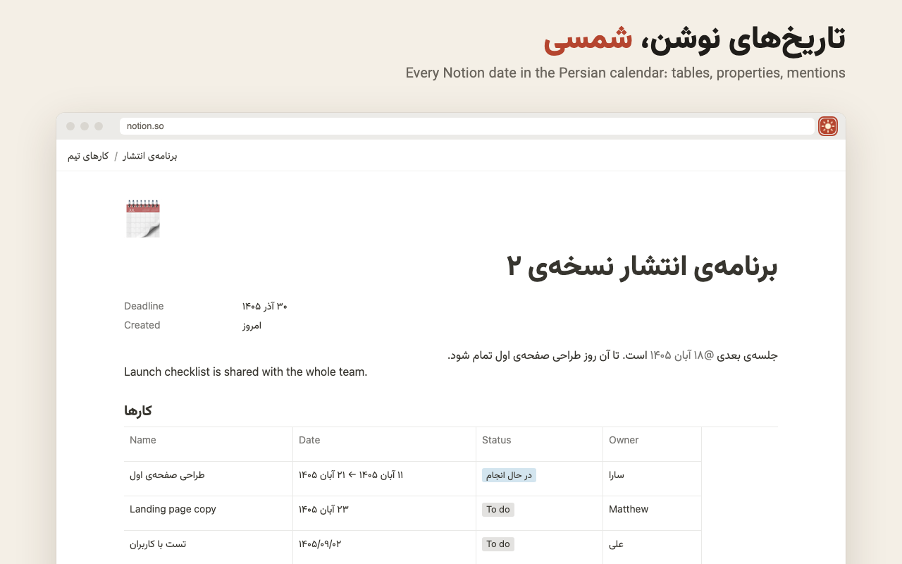
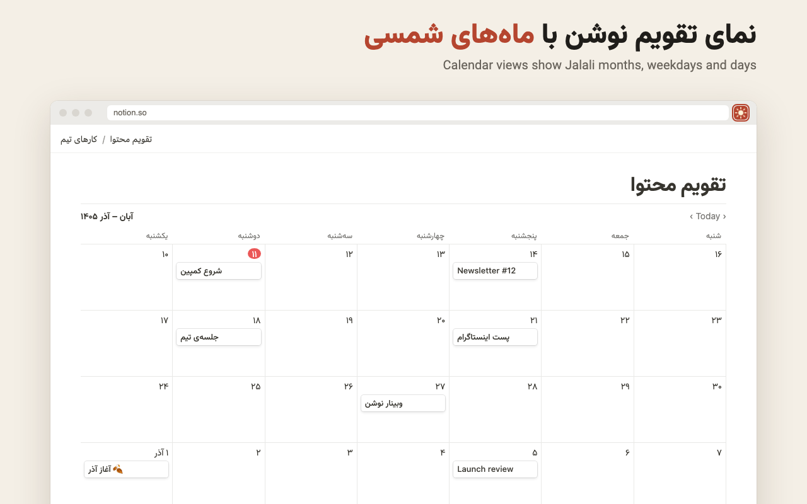
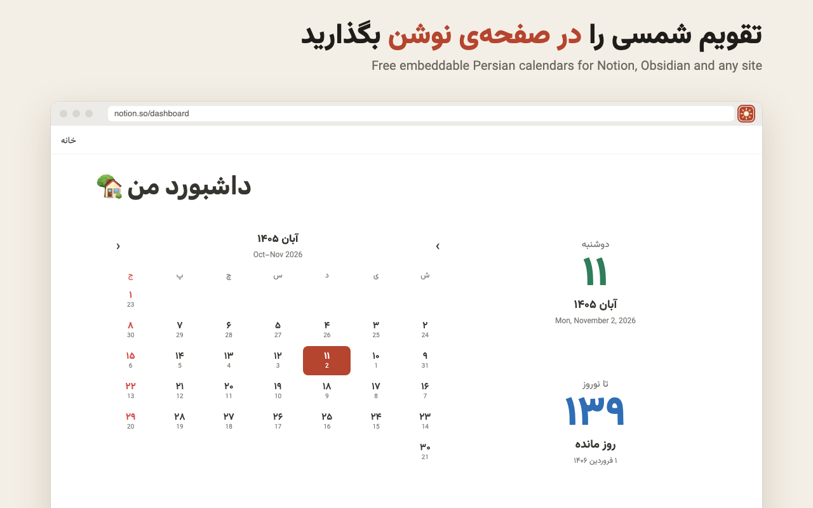
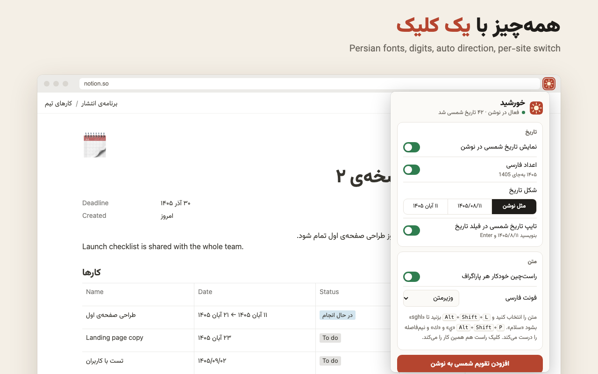
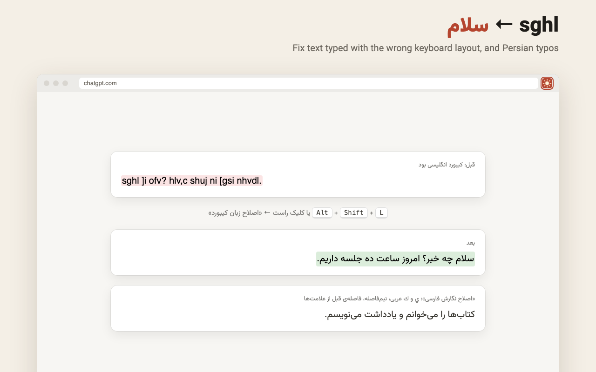

<div dir="rtl">

# خورشید

تاریخ شمسی، فونت فارسی و راست‌چین برای نوشن و هر سایتی، به‌علاوه‌ی تقویم شمسی رایگان برای جاسازی در صفحه‌های نوشن.

[نصب از Chrome Web Store](https://chromewebstore.google.com/detail/dhkfoinnpjgabapcgjkmjophfincioij) · [ساخت تقویم برای نوشن](https://truthofmatthew.com/projects/khorshid/calendar/fa/) · [گزارش مشکل](https://github.com/truthofmatthew/khorshid/issues)

</div>



**Khorshid** (خورشید, "sun") is a Chrome extension that makes Notion work in Persian: every date shows in the Jalali (Shamsi) calendar, Persian text gets a proper font, and paragraphs pick their own direction. It also fixes text typed on the wrong keyboard layout anywhere on the web, and comes with free Persian calendar widgets you can embed in Notion, Obsidian or any site.

## What it does

| | |
|---|---|
| **Jalali dates in Notion** | Table and board dates, page properties, `@date` mentions, ranges and times. `Today` becomes `امروز`. |
| **Calendar views** | Month headers (`آبان – آذر ۱۴۰۵`), Persian weekday names and Jalali day numbers. |
| **Type Jalali dates** | Type `۱۴۰۵/۸/۱۱` in a Notion date field and press Enter; Notion saves the right day. |
| **Persian fonts** | Vazirmatn, Estedad, Sahel, Shabnam, Samim, Parastoo. Only Persian letters change; English keeps Notion's font. |
| **Auto direction** | Each paragraph, table cell and card takes the direction of its first letter. Code stays left-to-right. |
| **Wrong-layout fix** | Select `sghl` and press <kbd>Alt</kbd>+<kbd>Shift</kbd>+<kbd>L</kbd> to get `سلام` (and back). Works on any site. |
| **Persian typing fix** | <kbd>Alt</kbd>+<kbd>Shift</kbd>+<kbd>P</kbd> turns Arabic `ي`/`ك` into `ی`/`ک` and adds half-spaces (`می‌روم`, `کتاب‌ها`). |
| **Other sites** | Turn fonts and auto direction on for ChatGPT, Gmail, Slack or any site, one site at a time, from the popup. |
| **Calendar widgets** | Month, today, week strip and countdown. Pick a style at [truthofmatthew.com/projects/khorshid/calendar](https://truthofmatthew.com/projects/khorshid/calendar/), then `/embed` the link in Notion. |






## How it works

- Dates are never edited in Notion. Each date label gets a `data-kh` attribute and CSS draws the Jalali text in its place, so nothing Jalali is saved to your pages and Notion's re-renders can't break it.
- Date labels are found by their text (`Nov 2, 2026`, `2026/11/02`, `Today`…), not by Notion's class names, which change without notice. The calendar-view grid is the one place that still relies on Notion's `.notion-calendar-view` classes.
- Jalali conversion uses the browser's built-in Persian calendar (`Intl.DateTimeFormat` with `ca-persian`). No date library.
- Nothing leaves the browser. See the [privacy policy](https://truthofmatthew.com/projects/khorshid/privacy/).

## Develop

```bash
npm install
npm test          # date conversion, Notion label parsing, typing fixes
npm run build     # dist/extension (load unpacked) and dist/web (served at /projects/khorshid/)
npm run zip       # dist/khorshid-extension.zip for the Chrome Web Store
node store/render.mjs   # store screenshots, promo tile and icons (needs Chrome or Edge)
```

Load `dist/extension` from `chrome://extensions` with Developer mode on.

```
src/core/     Jalali dates, Notion date parsing, typing fixes, fonts, holidays (no browser APIs)
src/ext/      the extension: Notion content script, other-sites script, popup, background
src/web/      calendar widget, calendar builder, privacy page
store/        screenshot scenes and the renderer
```

## Credits

Fonts by Saber Rastikerdar and Amin Abedi, under the SIL Open Font License ([list](public/fonts/FONTS.md)).
Made by [Matthew Truth](https://truthofmatthew.com).
